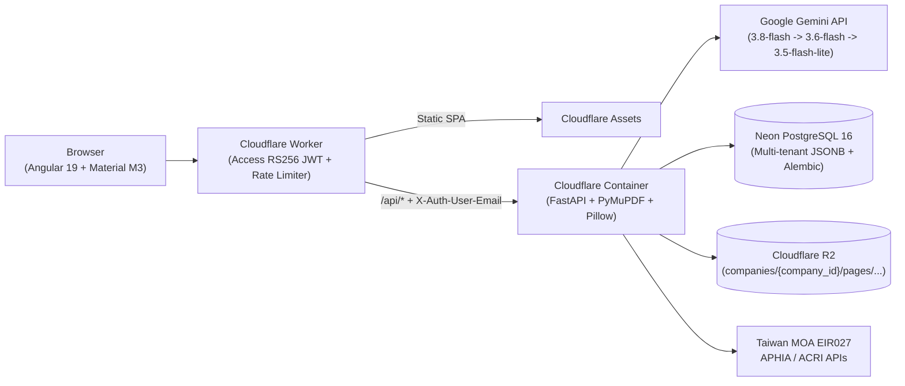

# Compliance Agent

**Citation-grounded AI regulatory compliance workspace for agrochemical and specialty chemical Regulatory Affairs (RA) teams.**

[](https://compliance-agent.j842671395.workers.dev/)
[](https://github.com/Haohaoscreamandrun/compliance_agent/actions/workflows/ci-cd.yml)
[](backend/pyproject.toml)
[](frontend/)
[](backend/alembic/)
[](backend/app/services/parser.py)
[](LICENSE)

> **Live Demo:** [**https://compliance-agent.j842671395.workers.dev/**](https://compliance-agent.j842671395.workers.dev/)
> Click into the **zero-login public demo (`農藥進99001`)** to explore a cached compliance audit, inspect crop-usage gaps (`未登載使用範圍`), and open the side-by-side **`查看差異`** bounding-box viewer immediately. Uploading private documents or running fresh company audits is gated by Cloudflare Access login and admin company approval.

---

## Why This Exists

Agrochemical RA specialists managing 10–500+ registered permits routinely spend hours manually cross-checking bilingual documents whenever a foreign manufacturer changes, an MSDS is revised, or a new government bulletin lands:

- **Global inputs (English / bilingual):** Notarized factory/source-change certificates (LoA / MoC), 16-section GHS MSDSs.
- **Taiwan local baselines (Traditional Chinese):** 3-page APHIA statutory product labels, MOA `EIR027` permit records, APHIA carcinogen/ban notices, ACRI 15-year assessments, and official government letters (公文).

**Compliance Agent** automates this cross-referencing into a deterministic, auditable **Label Update Checklist**—where every finding links directly back to interactive `[doc_id, page, box_2d]` vector highlights on the source documents rather than ungrounded chatbot prose.

<!--
## Preview

> Demo GIF & screenshots coming soon — store synthetic demo captures in `docs/assets/` (already allowlisted in `.gitignore`):
> - `docs/assets/demo-walkthrough.gif` — Checklist → `查看差異` side-by-side SVG highlight → Light/Dark toggle
> - `docs/assets/workspace-dark.png` — Dark mode audit workspace with bounding-box overlay
> - `docs/assets/diff-viewer-light.png` — Light mode side-by-side diff viewer
-->

---

## Key Features

- **Chain-of-Grounding Multimodal Parsing (`GroundedField[T]`):** Combines a `PyMuPDF` digital-text fast path with high-resolution WebP rendering (`Pillow`) and `Gemini` constrained JSON decoding (`gemini-3.8-flash` with automatic timeout & `503` failover to `gemini-3.6-flash` / `gemini-3.5-flash-lite`). Attaches the official APHIA `GHS01–GHS09` reference legend during label/MSDS parsing and aligns extraction with Taiwan's 3-page statutory label layout.
- **Live Taiwan Government Integrations:**
  - **MOA `EIR027` OpenData API:** On-call lookup across 5 official endpoints (permit master, `農藥使用範圍`, `許可證標示`, `農藥條碼資料`, `混合劑百分率`) cached in PostgreSQL.
  - **APHIA & ACRI Intelligence:** Fetches APHIA announcements, forbidden/carcinogen PDFs, and ACRI 15-year evaluation assessments & pre-notices.
- **Two-Phase Compliance Copilot & Deterministic Cascade Diff:**
  - **Phase 1 (Tools):** Runs deterministic SQL/Python checks over PostgreSQL `JSONB` (factory/entity alignment, GHS pictogram & H/P-statement drift, MOA sync state, crop usage table comparison against `approved_usages_json`, and open 公文 mandates) with `100%` clause recall.
  - **Phase 2 (Structured Synthesis):** Detaches tools and enforces `response_schema=ComplianceAuditReport` for guaranteed frontend JSON.
- **Interactive Side-by-Side Workspace (Angular 19 + Material M3):** Framed-sheet Light/Dark UI with `未登載使用範圍` crop-usage tab, single `查看差異` side-by-side viewer, zoom/magnifier, inline `<svg viewBox="0 0 1000 1000">` bounding-box overlays, multi-volume baselines, batch upload, and bilingual entity alias management.
- **Multi-Tenant Isolation & Edge Hardening:** Cloudflare Workers verifies Cloudflare Access `RS256` JWTs at the edge, sanitizes client headers, enforces per-email rate limits (`10 req / 60s` on Gemini `POST` routes), isolates PostgreSQL records and R2 page keys (`companies/{company_id}/pages/...`) per tenant, and gates onboarding via admin-approved access requests. See [docs/security/SECURITY.md](docs/security/SECURITY.md).

---

## Production Architecture



---

## Quick Start (Local Development)

1. **Clone the repository:**

   ```bash
   git clone https://github.com/Haohaoscreamandrun/compliance_agent.git
   cd compliance_agent
   ```

2. **Configure environment variables (`.env` is git-ignored and never pushed):**
   Create a local `.env` file in the repository root with `GEMINI_API_KEY`, `POSTGRES_USER`, `POSTGRES_PASSWORD`, and `POSTGRES_DB` (or `DATABASE_URL`).
   - **Data Privacy Requirement:** Ensure the Google AI Studio project tied to `GEMINI_API_KEY` has **Pay-as-you-go billing enabled (Paid tier)** before uploading confidential certificates or unpublished MSDSs so inputs are excluded from model training.
   - **Optional GCP Vertex AI Mode:** Set `GOOGLE_GENAI_USE_VERTEXAI=true`, `GOOGLE_CLOUD_PROJECT`, and place any local service-account key inside `./secrets/` (git-ignored). When `GOOGLE_GENAI_USE_VERTEXAI=true`, the backend ignores `GEMINI_API_KEY`.

3. **Start the full local stack with Docker Compose:**

   ```bash
   docker compose up --build
   ```

   - Angular + Angular Material UI: `http://localhost:4200`
   - FastAPI Backend & OpenAPI docs: `http://localhost:8000/docs`

---

## Commands

| Command | Description |
| :--- | :--- |
| `docker compose up --build` | Start local PostgreSQL 16 (`db`), FastAPI (`backend`), and Angular (`frontend`) |
| `cd backend && pytest -v` | Run backend unit, parser, tenancy, identity, diff, and API tests |
| `cd backend && alembic upgrade head` | Apply PostgreSQL schema migrations (`001`–`003`) |
| `cd backend && uvicorn app.main:app --reload` | Start FastAPI dev server on `127.0.0.1:8000` |
| `cd frontend && npm start` | Start Angular dev server on `http://localhost:4200` |
| `cd frontend && npm run build` | Verify production Angular + Angular Material build |
| `cd frontend && npx ng test --watch=false --browsers=ChromeHeadless` | Run Angular unit tests |
| `npx tsc -p tsconfig.worker.json` | Typecheck Cloudflare Worker edge gateway |
| `npm run cf:dry-run` | Validate Cloudflare Worker + Container + R2 bundle via Wrangler |
| `git check-ignore -v <path>` | Verify `.gitignore` blocks confidential RA documents and secrets |

---

## Repository Structure

```text
compliance_agent/
├── .github/workflows/ci-cd.yml     # Automated pytest, Angular tests, Alembic migrate & Wrangler deploy
├── .gitignore                      # Public-repo guardrails (blocks .env*, /secrets/, confidential RA docs)
├── docker-compose.yml              # Local container orchestration (PostgreSQL 16, FastAPI, Angular)
├── wrangler.jsonc                  # Cloudflare Workers, Containers, R2, and per-email ratelimits config
├── src/
│   ├── worker.ts                   # Edge gateway: SPA routing, security headers, rate limiting, container proxy
│   ├── accessAuth.ts               # Cloudflare Access RS256 JWT verification & header sanitization
│   └── accessAuth.test.ts          # Worker auth & rate-limit tests
├── docs/
│   ├── intent/label-compliance-mvp.md          # Confirmed Statement of Intent
│   ├── decisions/ADR-001-system-decisions.md   # Architecture Decision Record & forfeited alternatives
│   └── security/SECURITY.md                    # Security & hardening ledger (edge auth, tenancy, audits)
├── tasks/
│   ├── plan.md                     # Component 11 multi-tenant isolation & onboarding plan
│   └── todo.md                     # Ordered small-CL task tracker
├── backend/                        # Python 3.12 + FastAPI + SQLAlchemy 2.0 (asyncpg) + google-genai
│   ├── alembic/versions/           # Database migrations (001–003 company tenancy)
│   ├── app/
│   │   ├── assets/                 # Official APHIA GHS01–GHS09 reference legend
│   │   ├── config.py               # pydantic-settings v2 loader + Neon/asyncpg URL normalization
│   │   ├── db/                     # Multi-tenant PostgreSQL 16 JSONB models, session, seed fixtures
│   │   ├── schemas/                # GroundedField[T], 4 extraction schemas, ComplianceAuditReport
│   │   ├── prompts/                # Taiwan 3-page statutory label, LoA/MoC, MSDS & Copilot prompts
│   │   ├── services/               # Preprocessor, Gemini parser + failover, MOA/APHIA clients, diff, R2 storage
│   │   └── api/                    # REST routes (registry, documents, copilot, entity-aliases, identity/admin)
│   └── tests/                      # Pytest suite + synthetic fixtures
└── frontend/                       # Angular 19 + Angular Material M3 workspace
    └── src/app/
        ├── models/                 # TypeScript interfaces mirroring backend Pydantic schemas
        ├── services/               # HttpClient service for FastAPI endpoints
        └── components/             # bbox-svg-viewer, copilot-audit-panel, upload-dialog, alias & join-company dialogs
```

---

## Technology Decisions & Forfeited Alternatives

Full rationale is documented in [docs/decisions/ADR-001-system-decisions.md](docs/decisions/ADR-001-system-decisions.md).

| Subsystem | Chosen Tool / Pattern | Forfeited Alternatives | Rationale |
| :--- | :--- | :--- | :--- |
| **Database** | **Single PostgreSQL 16 (`JSONB`) on Neon**<br>*(in-place `pgvector` path deferred)* | **Qdrant Cloud** + Dual SQL/Vector store; Vector-first RAG | Avoids dual-store split-brain bugs on updates/deletes. Cross-language matching (`Carbendazim` ↔ `貝芬替`) depends on canonical join keys (`reg_no`, `common_name`, CAS), and 2–15 page certificates need `100%` clause recall via SQL rather than top-*k* vector approximation. |
| **Document Parsing & BBoxes** | **Unified `PyMuPDF` + `Pillow` + `Gemini Flash / Flash-Lite`** (`response_schema` + native `box_2d`) | **IBM Docling**, **Mistral OCR**, **DocLayout-YOLO**, **RapidOCR**, **MinerU**, **Marker** | Eliminates coordinate-system mismatches and multi-GB OCR weights. Native VLM constrained decoding handles Taiwan 公文 red seals, ROC dates (`民國年`), and visual `GHS01–GHS09` pictograms in one pass, with a `PyMuPDF` digital-text fast path for text-native MSDSs. |
| **Gov Registry Ingestion** | **On-Call `httpx` Lookup + MOA `EIR027` / APHIA / ACRI APIs** (with PostgreSQL cache) | **`Crawl4AI` / `Playwright`** scraping; Bulk weekly cron jobs (`APScheduler`) | `MOAOPD-API-EIR027` supports `$filter` and 4 JSON sub-endpoints natively, so on-call lookup takes `<1s` without headless browsers or background schedulers. |
| **Prompt & Output Control** | **`GroundedField[T]` Chain-of-Grounding** + **Two-Phase Copilot** | Single-turn `tools` + `response_schema`; Free-text Markdown tables | Autoregressive field ordering (`verbatim_text` → `value` → `page` → `box_2d`) grounds bounding boxes to transcribed tokens. Separating Phase 1 (Tools) from Phase 2 (Constrained JSON) avoids Gemini API tool/schema conflicts. |
| **Frontend UI** | **Angular 19 + Material M3** + Inline `<svg viewBox="0 0 1000 1000">` overlay | Raw HTML5 `<canvas>` pixel math, **React / Next.js**, **Streamlit**, **Gradio** | Maps Gemini's `0–1000` `box_2d` coordinates 1:1 in vector SVG without JS resize/DPI math, with side-by-side diff viewing and WCAG 2.1 AA bilingual (`zh-Hant`/`en`) accessibility. |
| **Edge & Multi-Tenant Cloud** | **Cloudflare Workers + Containers + R2 + Access JWT + Neon** | Self-managed VPS / Kubernetes; Unauthenticated edge proxies | Keeps auth verification, anti-spoofing header stripping, and per-email rate limiting at the edge while scaling Python/FastAPI containers and tenant-namespaced R2 storage with zero cluster ops. |

---

## 繁體中文簡介

**Compliance Agent** 是一款專為**農藥與特用化學品法規事務（RA）團隊**打造的 AI 標示合規審核系統，結合 **FastAPI**、**Angular 19 (Material M3)**、**PostgreSQL 16 (JSONB)** 與 **Cloudflare Workers / Containers / R2** 部署上線。

- **線上即時體驗：** [**https://compliance-agent.j842671395.workers.dev/**](https://compliance-agent.j842671395.workers.dev/)（免登入即可開啟公開展示許可證 **`農藥進99001`**，體驗合規稽核清單、**未登載使用範圍**比對與 **`查看差異`** 並排視覺標註）。
- **核心解決痛點：** 自動比對英文／雙語原廠文件（公證授權書 LoA、變更證明 MoC、16 章節 GHS MSDS）與台灣在地法規基準（農業部 `EIR027` 開放資料、防檢署 APHIA 公告／禁限用與致癌性清單、農藥所 ACRI 15 年評估資料、法定三頁式標示與政府公文）。
- **可驗證的視覺佐證：** 內建防檢署 `GHS01–GHS09` 標準危害圖式對照與 `box_2d` 座標定位，每一項標示修改建議皆可直接跳轉至原始文件對應頁次與框選區域。
- **企業級多租戶安全：** 透過 Cloudflare Access JWT 驗證、每信箱速率限制，以及資料庫與 R2 影像路徑的嚴格企業租戶隔離（詳見 [docs/security/SECURITY.md](docs/security/SECURITY.md)）。

---

## Contributing, Security & License

- **Branching Model:** `main` is the review-gated production branch (auto-deploys to Cloudflare + runs Alembic migrations on merge); active development lands on `develop` in small, single-concern CLs tracked in [tasks/todo.md](tasks/todo.md).
- **Public Repository Secret & Document Hygiene:**
  - Never commit `.env`, API keys, or GCP service account JSON files (store local GCP keys in `./secrets/`).
  - Real company certificates, MSDSs, label scans, and 公文 (`*.pdf`, `*.webp`, `*.png`, `*.jpg`, `*.odt`, `*.di`, `*.xlsx`, `*.csv`, `*.zip`) are blocked globally by [.gitignore](.gitignore); only synthetic fixtures under `backend/tests/fixtures/` and allowlisted UI/doc assets may be tracked.
- **License:** Released under the [MIT License](LICENSE).
